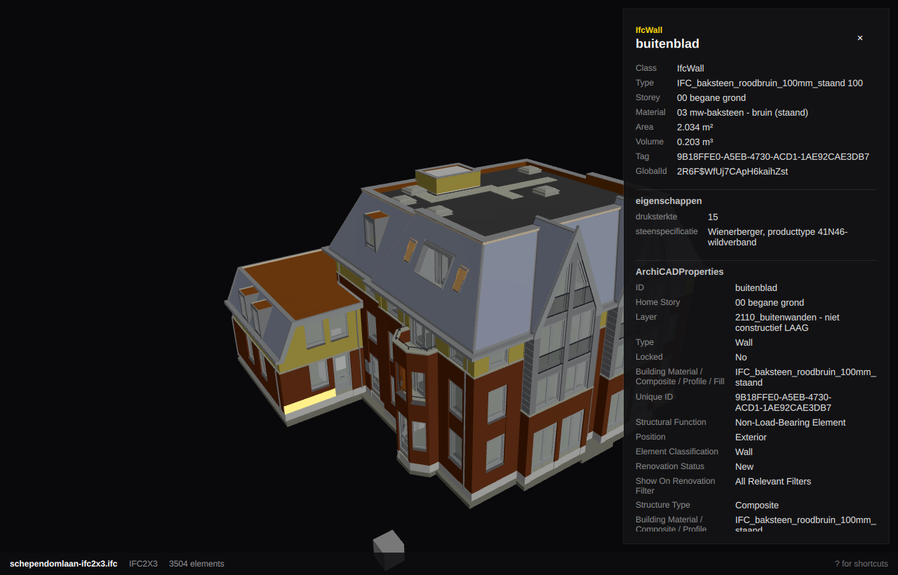

# Keystone

[](https://github.com/yamz8/keystone/actions/workflows/test.yml)

A fast native 3D viewer for IFC building models, for the Omarchy desktop.



Open an `.ifc` file, orbit around the building, and click any element to see
what it is: its class, type, storey, materials, area, volume, and every
property set and quantity the file gives it. IFC2x3, IFC4, and IFC4x3 all
work.

- **Storeys**: a slider peels floors away from the top, one at a time.
- **X-ray**: show only the structure, the MEP services, or the architecture,
  with everything else a faint ghost around it.
- **Sections**: cut the building with a horizontal plan plane or a vertical
  one, and drag it through with Alt.
- **Elements**: every element listed under its storey, searchable by name,
  class, storey, or GlobalId.

Keystone follows Omarchy: the viewport sits on your theme's background, the
selection takes the theme's accent, corners follow Hyprland's rounding, and
the window speaks the language picked under Setup > Language.

## Shortcuts

| Key | Action |
| --- | --- |
| Ctrl+O | Open a model (or drop an `.ifc` file on the window) |
| Click | Select an element |
| Drag | Orbit |
| Right drag, or Shift+drag | Pan |
| Wheel, or pinch | Zoom towards the pointer |
| Double-click | Select and frame an element |
| Space | Frame the selection, or the whole model |
| Home | Reset the view |
| 1 2 3 4 | Front, side, back, and top views |
| ← → ↑ ↓ | Orbit |
| + − | Zoom in and out |
| I | Show or hide properties |
| T | Show or hide the element list |
| Ctrl+F | Search elements |
| PgUp PgDn | Show more or fewer storeys |
| X | X-ray: all, structure, MEP, architecture |
| S | Section: off, plan, X, Z |
| [ ] | Move the section plane |
| Alt+drag | Drag the section plane |
| F | Keep the other side of the section |
| Esc | Clear the selection |
| ? | Show or hide shortcuts |
| Q | Quit |

## Commands

The same reading of a model works without a window, for scripts and coding
agents. Each command takes `--json`, exits 0 or 1, and never changes the file.

```sh
keystone info model.ifc                    # schema, storeys, element counts by class
keystone elements model.ifc --class IfcDoor  # GlobalId, class, name, and storey of each
keystone properties model.ifc 2R6F$WfUj7CApH6kaihZst
keystone skill install                     # teach Claude Code and other agents to use these
keystone open model.ifc                    # the viewer (keystone model.ifc works too)
```

## How it works

[IfcOpenShell](https://ifcopenshell.org)'s `IfcConvert` triangulates the
model into a Wavefront OBJ with one group per element, named by its GlobalId.
Keystone runs it in the background, reads the OBJ, and draws the model with
Qt Quick 3D, one draw call per material. Openings, spaces, and spatial zones
are left out, as they are volumes rather than things.

Properties come from the IFC file itself: Keystone indexes the STEP text once
and reads an element's attributes, relationships, property sets, quantities,
and units when you select it. (IfcConvert's own XML export crashes on some
IFC2x3 files, which is most of what's out there.) When a file carries no area
or volume for an element, Keystone measures them from its geometry and says so.

Triangulating is most of the wait on a real building, so the converted
geometry is kept in `~/.cache/keystone/models`, keyed by the file's path,
size, and time, for the twelve most recently opened models and up to 2 GB.
Your `.ifc` files are only ever read. On four cores:

| Model | Size | Elements | First open | Again |
| --- | --- | --- | --- | --- |
| buildingSMART samples | 0.1–2 MB | 5–48 | under 2 s | instant |
| Schependomlaan | 49 MB | 3,504 | 16 s | 0.8 s |
| An 18-storey Italian residential tower | 73 MB | 11,123 | 3 min 50 s | 24 s |

Picking goes through a bounding-volume hierarchy over every triangle, and the
storey slider, X-ray, and sections redraw without re-reading anything.

## Building

Keystone is C++17 and Qt Quick, built with qmake6 and make into one binary.

```sh
bin/fetch-ifcconvert   # IfcConvert 0.9.0 into vendor/, once
bin/build              # build/keystone
bin/test               # the Qt Test suite, offscreen
bin/install            # makepkg -fsi: installs it so it shows up in the launcher
```

`build/keystone open model.ifc` opens a model straight away. Set
`KEYSTONE_IFCCONVERT` to use a different IfcConvert. GitHub Actions builds
and tests every push on Arch Linux.

The package bundles IfcConvert under `/usr/lib/keystone/ifcconvert` and
registers `application/x-ifc` for `.ifc` files.

## License

MIT for Keystone; see [LICENSE](LICENSE). The bundled IfcConvert is
IfcOpenShell's, under the LGPL 3.0 or later.
